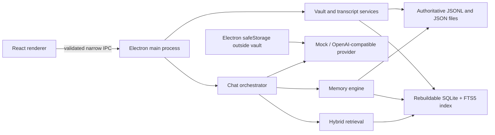
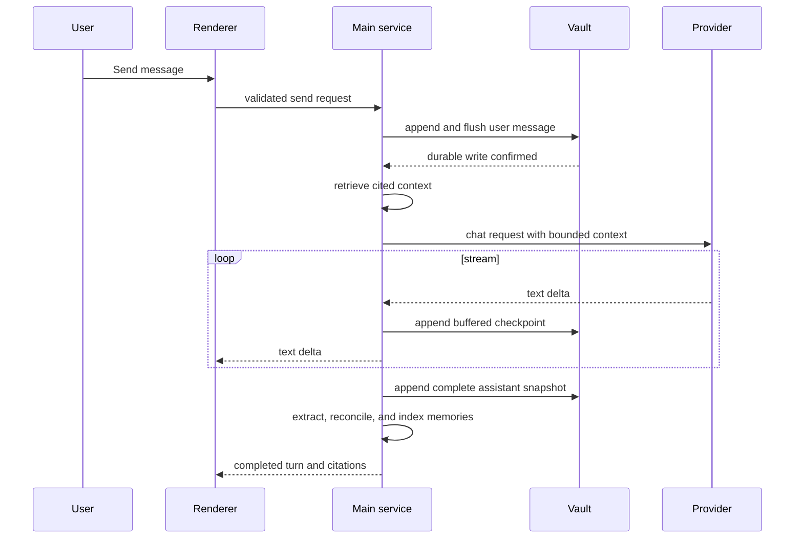
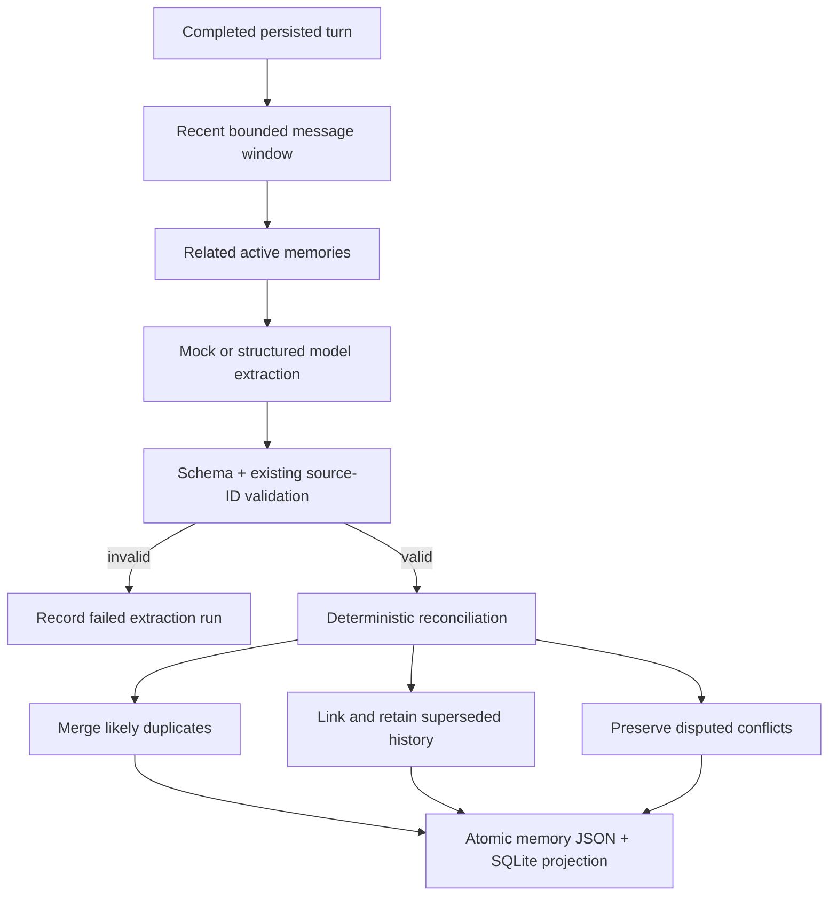

# Architecture

## Components

The renderer cannot access Node or the filesystem. The main process owns all persistence and network operations. IPC request and response payloads are validated with Zod and limited to named operations.

## Conversation data flow

Provider invocation is impossible until the user write succeeds. Cancellation or failure appends a terminal snapshot while keeping partial assistant content.

## Storage data flow

The vault manifest establishes identity independently of drive letter. Project/chat metadata is written through same-directory temporary files followed by atomic replacement. A chat transcript is an append-only JSONL event stream. Each line is a validated message snapshot; replay takes the newest snapshot for each immutable message ID, preserving prior checkpoints. Critical appends flush the file handle before return.

SQLite contains a rebuildable projection of manifests, metadata, latest message snapshots, memories, relationships, extraction runs, embeddings, migrations, and FTS5 rows. The database uses `journal_mode=DELETE`, `synchronous=FULL`, foreign keys, and a busy timeout to avoid WAL assumptions on removable media.

## Extraction and reconciliation

User-confirmed memories are never silently overwritten. Every accepted candidate must reference exact existing messages. Proposal language is not promoted to a decision; completion language can resolve a related commitment; rejected options are stored as rejected and excluded from default retrieval.

## Retrieval flow

FTS5 supplies keyword candidates for messages, memories, and chat titles. Optional stored embeddings add cosine similarity. Ranking first requires lexical or semantic relevance, then combines exact/keyword match, semantic similarity, project affinity, confirmation, pinned state, confidence, recency, and lifecycle penalties. Superseded, deleted, and rejected items are excluded by default. When no structured memory survives the relevance gate, the engine searches prior indexed messages outside the current chat and may supply bounded transcript excerpts instead. Selected items are truncated to configured item and character budgets and include exact source chat/message/excerpt metadata. Only that bounded context is added to the provider request, and the assistant snapshot records IDs for every injected context item.

## Failure handling

- Missing vault: the UI enters a prominent disconnected state; content actions are disabled and no fallback transcript is created.
- Provider failure: persisted user input remains; partial assistant output receives `failed`, `cancelled`, or `interrupted` state and can be retried without another user record.
- Extraction/embedding failure: chat remains complete and searchable by keyword; the failed derived operation is recorded without blocking chat history.
- Corrupt SQLite: close and rebuild it from authoritative project/chat/transcript/memory files.
- Malformed transcript line: retain the source file, report the line as a recovery issue, and index other valid lines.
- Changed drive letter: selecting the vault root reconnects by manifest ID.

## Security boundaries

- `contextIsolation: true`, `nodeIntegration: false`, sandboxed renderer, a strict CSP, navigation denial, and new-window denial.
- The preload exposes a frozen domain API, never raw IPC or filesystem primitives.
- Main-process handlers validate IDs, settings, paths, and action payloads.
- All vault paths are resolved beneath a validated vault root; filename slugs are sanitized and never used as identity.
- Model text renders as plain text in the MVP, avoiding unsafe HTML.
- API keys are encrypted through Electron `safeStorage` outside the vault and never returned to the renderer after saving.
- Logs and diagnostics exclude prompt, response, memory statement, key, authorization header, and file content.
